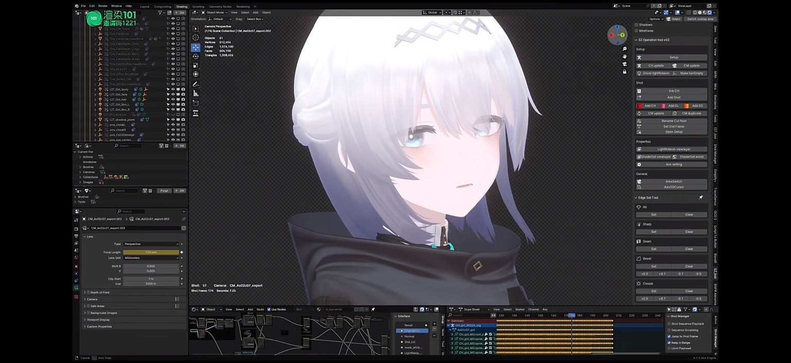
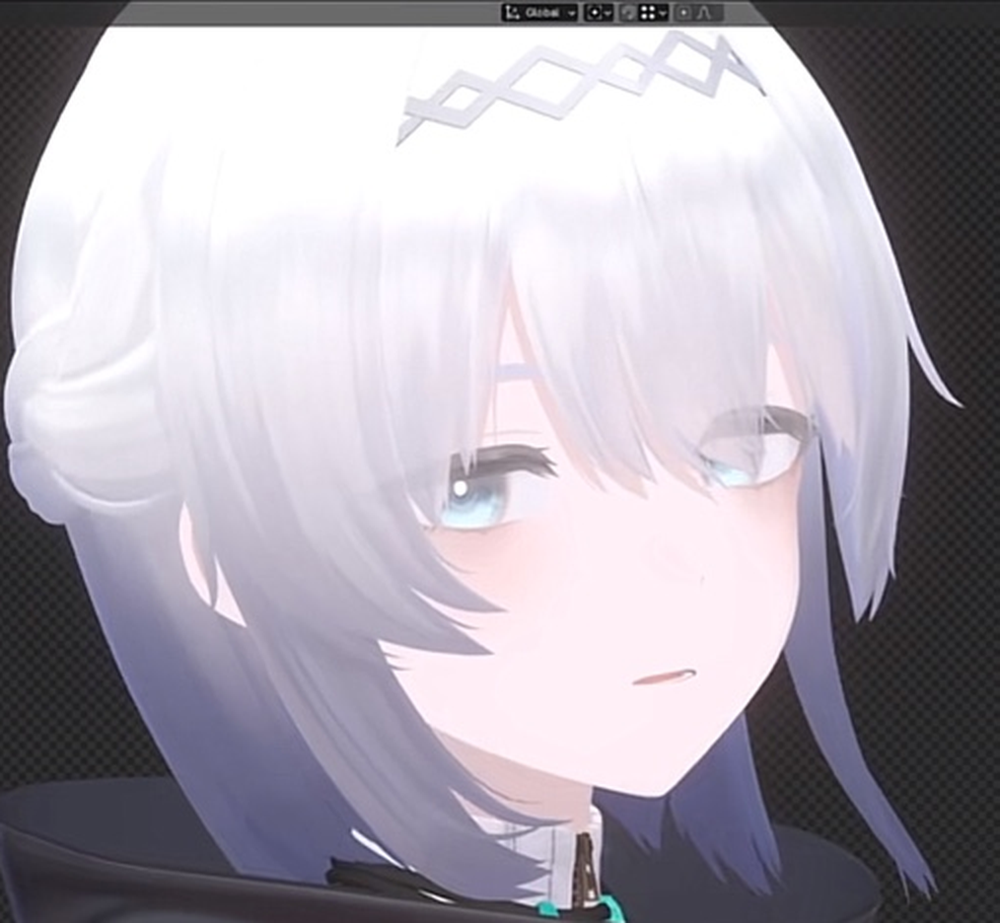
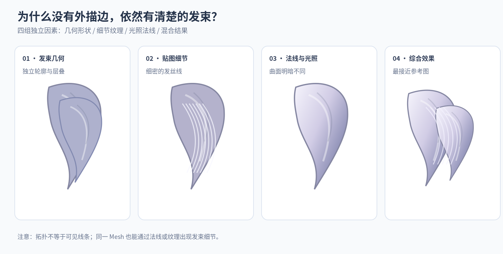
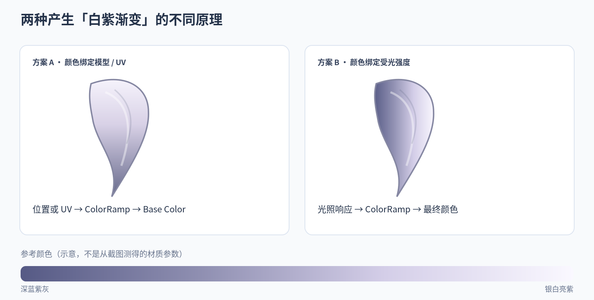
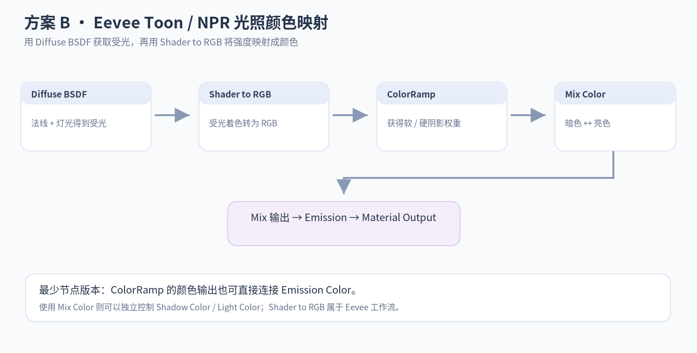
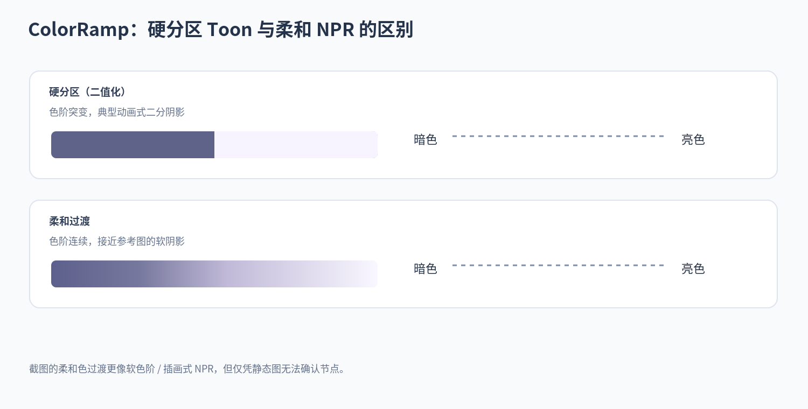
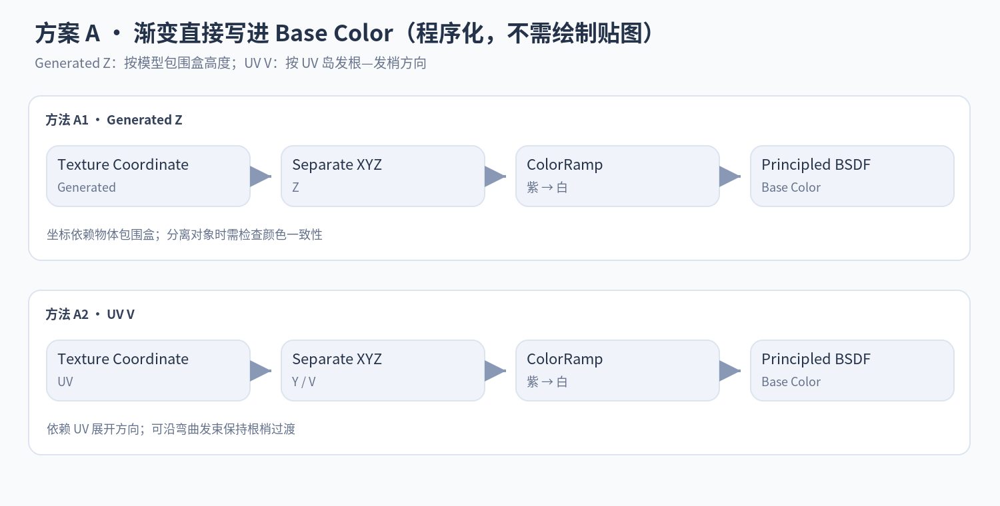
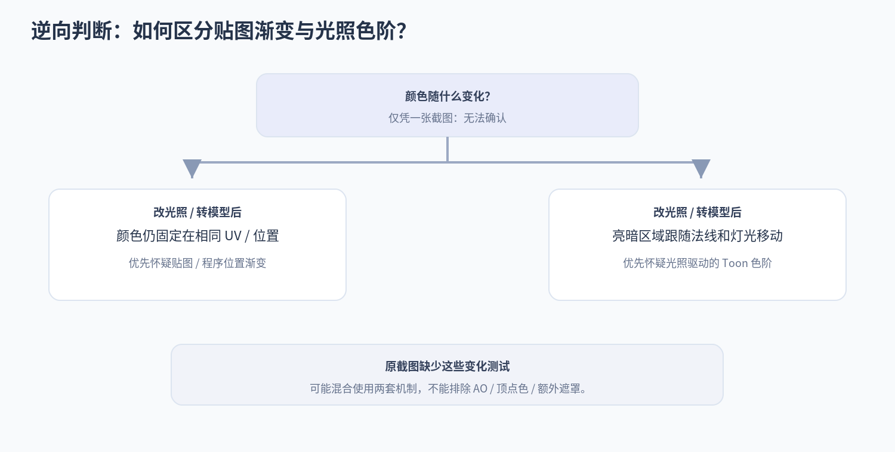

# Blender 二次元头发：发束、法线、渐变 Base Color 与 Toon Shading

> **主题**：对一张 Blender 二次元角色头发截图进行视觉逆向分析，并整理可以自行复刻的节点工作流。  
> **软件方向**：Blender / Eevee、Stylized Shading、NPR / Toon Shading。  
> **图片路径**：统一为相对路径 `./images/Anime-Hair-Shader/`，可在 Typora 中离线打开。  
> **重要前提**：没有作者的 `.blend` 工程，也没有可验证的材质节点图。本文的原图观察是**推断**，不是对作者真实制作流程的确认。本文其余节点图和形状图为**教学示意图**，不冒充作者文件截图。

---

## 1. 原图与我们想解决的问题



*图 1：用户提供的原始截图；关注白色头顶、银白刘海、灰紫内层和发梢。*



*图 2：从原始截图裁出的头发局部。放大不代表获得了作者的材质信息，局部视频压缩和分辨率也可能影响线条外观。*

最初观察：

1. 模型**没有特别明显的黑色头发描边**，但依然能看出一缕一缕的发束。
2. 头顶接近银白，头发内层、后方和下方偏蓝紫灰。
3. 这些颜色可能来自 **Base Color 本身的渐变**，也可能来自 **Shader 根据光照把深蓝紫色映射成浅紫 / 银白**。
4. 后续比较后，我们**不优先猜测每束头发都在使用发根到发梢的 UV 渐变**；光照映射值得优先尝试，但仍不可确认。

**核心结论**：在没有工程文件的情况下，不能从一张静态图可靠地区分“Base Color 渐变”和“受光渐变”，而且两种做法可以同时使用。

---

## 2. 没有明显描边，为什么仍有一缕一缕的感觉？



*图 3：重绘的教学示意：几何、贴图、法线光照以及混合的效果。形状是简化演示，不是从原始模型提取的 Mesh。*

### 2.1 Mesh 与拓扑：不是同一层含义

- **Mesh 几何形状**：发束有厚度、弯曲、尖锐发梢、彼此交叠。即使没有黑色 Outline，轮廓和遮挡关系仍能说明“这是不同的发束”。
- **Topology（拓扑）**：描述顶点、边、面的连接方式。拓扑影响发束能否平顺变形和表面法线质量，但渲染器不会自动把每条拓扑边画成发丝线。
- **Normals（表面法线）**：决定曲面如何对光作出反应。相邻部分即便同色，只要法线不同，也可能一明一暗。
- **贴图（Base Color / Normal Map）**：可以添加低对比度发丝线条、局部明暗或细小方向变化，而不必增加大量实际几何。
- **遮挡与 AO**：内外层发束相互压住时，会出现更深的明暗层次；但不能根据截图断定用了 AO 节点或某一项渲染设置。

> **纠正一个容易混淆的说法**：发束感不等于“有拓扑”。真正可见的因素主要是**几何形状 + 表面法线 + 材质纹理 + 光照和遮挡**。

### 2.2 原图中能看见什么？

| 位置 | 视觉现象 | 较合理的解释 | 确定性 |
|---|---|---|---|
| 左右两侧的外翘发梢 | 有独立的尖锐轮廓 | 发束 Mesh 的轮廓与层次 | 高（限于可见形状） |
| 刘海内部的细浅线 | 低对比度、近似发丝走向 | Base Color 纹理、法线细节，或很细的几何明暗 | 低 |
| 盘发和内层发束 | 重叠处颜色变深 | 几何遮挡 + 明暗变化 | 中 |
| 顶部白、内层和下方紫 | 颜色与明暗同时变化 | 手动颜色渐变、受光映射、环境光 / 遮挡等均有可能 | 低 |

**“没有明显黑描边”并不严格等于“完全没有使用 Outline 技术”**：截图只能证明看不到明显粗黑外轮廓，不能排除非常浅的描边、局部轮廓增强或其他后期效果。

---

## 3. 原图发色的两种主要实现假设



*图 4：两种生成同样“白紫发色”视觉结果的机制。示例颜色不是从材质文件中读取的值。*

### 3.1 假设 A：渐变直接进入 Base Color

一种可能的材质逻辑是：

```text
空间位置（Generated Z / 自定义坐标）或 UV
                      ↓
                 ColorRamp
             紫灰 → 银白
                      ↓
          Principled BSDF.Base Color
                      ↓
                 材质受光
```

这里**先决定物体上每个位置是什么颜色**，后续再做光照。因此，头顶和发尾的渐变能够在灯光转动后仍保留在模型相应位置。

这不一定意味着有一张 Image Texture：程序化的 `ColorRamp` 也能直接生成 Base Color 渐变。

### 3.2 假设 B：原发色偏蓝紫，Toon Shader 将受光区映射为银白

用户提出的思路：

> 原始头发可能本来就是蓝紫色，经过卡通 / 风格化光照，把受光部分映射成浅紫甚至接近白色。这样只需要一个主发色参数，不必给每一束头发单独画渐变。

这一思路**技术上完全可行**。例如：

```text
基础发色参数：蓝紫灰
                   +
          法线 / 灯光 / 遮挡关系
                   ↓
            受光强度 L
                   ↓
      风格化映射 ColorRamp
                   ↓
        暗部：蓝紫灰 → 亮部：银白
                   ↓
                最终颜色
```

示意数学关系：

\[
C_{final}=\operatorname{mix}(C_{shadow}, C_{light}, f(L))
\]

其中：

- `L`：受光强度（可以由 Shader to RGB 路线取得风格化控制所需的输入）。
- `f(L)`：ColorRamp 给出的明暗控制权重。
- `C_shadow`：阴影颜色，例如深蓝紫灰。
- `C_light`：亮部颜色，例如银白 / 浅紫。

**注意**：仅用标准白光照在蓝紫 Base Color 上，不会自动把漫反射颜色变成任意的银白色。若要稳定获得特别亮的银白区域，通常需要额外的**亮部颜色映射、风格化高光或其他艺术控制**。

### 3.3 为什么截图让我们更愿意先试假设 B？

观察上，刘海末端有些地方仍近白，而高度相似的内层发束却偏紫。这与“**同样的高度，不同法线或遮挡 → 不同颜色**”相容；如果使用非常简单的“整个头部按 Z 高度渐变”，就不太容易独立解释这些局部差异。

但是，**不能因此排除假设 A**：作者可以使用单独的发束 UV、局部遮罩、顶点色、不同材质区或混合方法。原图只能支持“优先验证 B”，不能证明“作者使用 B”。

### 3.4 示例发色

颜色仅是复刻起点，而不是原始材质实测参数：

| 用途 | HEX 参考值 | 角色 |
|---|---|---|
| 深阴影 | `#565A85` | 蓝紫灰 |
| 中等阴影 | `#9090B2` | 浅蓝灰紫 |
| 过渡 | `#D4CEE8` | 浅紫灰 |
| 最亮处 | `#FAF8FF` | 接近银白 |

想做成参考图那种**柔和的插画发色**，就让中间色阶持续过渡，而不是只有二值的暗色和亮色。

---

## 4. Blender 中复刻 Toon / NPR 受光变色：Eevee 节点路线



*图 5：逻辑示意。不是作者的真实节点截图。`
Shader to RGB` 路线适用于 Eevee，不适用于照抄到 Cycles。*

### 4.1 最直接的节点链（两种自定义最终发色）

```text
Diffuse BSDF 〔可先设白色，仅作为受光来源〕
        Shader 输出
            ↓
       Shader to RGB
        Color 输出
            ↓
       ColorRamp
  〔暗处输出 0，亮处输出 1，过渡可调〕
       Color 输出
            ↓
     Mix Color 的 Factor
     ┌───────────────────────┐
     │ A：Shadow = 蓝紫灰    │
     │ B：Light = 银白浅紫   │
     └───────────────────────┘
            ↓
      Emission.Color
            ↓
    Material Output.Surface
```

操作步骤：

1. Blender 的渲染引擎选择 **Eevee**。
2. 新建材质，加入 `Diffuse BSDF`，可以先用白色作为光照采样材质。
3. 加入 `Shader to RGB`，将 `Diffuse BSDF` 的 Shader 接入。
4. 加入 `ColorRamp`，将 Shader to RGB 的 Color 接到 ColorRamp 的 **Fac**（颜色会转换成用于坡度映射的单值）。
5. 把 ColorRamp 的两个端点设为**黑和白**；黑白坡度代表“由暗到亮”的权重。把滑块拉近得到硬分界；适度拉开得到柔和过渡。
6. 加入 `Mix Color`：A 设置蓝紫灰，B 设置银白浅紫，将 ColorRamp 输出作为 Factor。
7. 将 Mix 的颜色结果输入 `Emission` 的 Color，再将 Emission 接到 `Material Output` 的 Surface。
8. 调整主灯光位置和 ColorRamp 阈值，观察是否出现“外部白、内层灰紫”的受光规律。

**另一种更短的节点路线**：不加 Mix Color，直接将 `ColorRamp` 的暗端设为紫灰、亮端设为银白，再连接到 `Emission.Color`。两种做法的区别主要在于颜色参数是否独立管理。

### 4.2 “Base Color 只有一个颜色”到底是什么意思？

这里要严格区分：

- **一个主发色参数**：可用一组颜色当作基础，再通过变暗、提亮、向白紫色混合派生亮部和暗部。这样能集中修改角色发色。
- **最终材质只输出一个 RGB 常量**：不可能同时显示多个自定义发色，除非叠加受光、贴图、遮罩等变化因素。
- **上面的双色 Mix 方案**：实际上是**两个最终颜色参数**（Shadow / Light），只是**不需要两张贴图**，也不需要每束单独画渐变。

若坚持只管理一个 Base Color 参数，可以派生：

```text
BaseColor = 蓝紫灰（一个主控参数）
    ├─ ShadowColor = BaseColor × 较低亮度系数
    └─ LightColor  = mix(BaseColor, 银白目标色, 较高混合权重)

受光权重 → Mix(ShadowColor, LightColor) → Emission
```

这仍然有“银白目标色”等风格参数，但主发色可集中调节。纯粹用一个蓝紫常量 + 普通写实漫反射，不会自行创造银白的特殊 Toon 亮色。

### 4.3 硬二分阴影与柔和 NPR 的差别



*图 6：ColorRamp 对阴影转换函数的影响。原图更接近柔和过渡，但这是风格判断，不是渲染管线证明。*

- **硬 Toon**：ColorRamp 端点非常靠近，亮暗边界突然变化。
- **软 NPR / 插画光照**：ColorRamp 保留过渡区，可加入中间颜色，看起来更柔和。
- **渐变区域的位置**：由法线、灯光、阴影和遮挡关系决定；ColorRamp 只是重新分配颜色或控制过渡范围。

### 4.4 注意事项

- 使用上述 `Emission` 最终输出，是为了避免已经设计好的颜色再受普通 PBR 漫反射重复影响；它**不会自动保留标准 Principled BSDF 的所有写实材质特性**。
- 基础受光信号仍来自前面的 Diffuse BSDF。它是否包含预期的阴影、环境等因素，要用具体场景检查。
- `Shader to RGB` 是 **Eevee 工作流**。Cycles 不能直接用同一节点链照搬结果。
- 头发的**独立高光带**（stylized hair specular highlight）是另一层问题，可单独做定向高光遮罩；不能简单把 Fresnel 当成通用发丝高光。Fresnel 主要反映视角与法线夹角关系。

---

## 5. 如果不用 Toon，而是直接制作渐变 Base Color

这个方案也非常简单，而且**不要求手绘图片纹理**。



*图 7：两种程序化 Base Color 渐变的常见输入方式。*

### 5.1 方法 A：Generated Z + ColorRamp

```text
Texture Coordinate.Generated
             ↓
      Separate XYZ.Z
             ↓
         ColorRamp
   0 = 蓝紫灰，1 = 银白
             ↓
   Principled BSDF.Base Color
             ↓
     Material Output
```

步骤：

1. 增加 `Texture Coordinate`。
2. `Generated` 输出连接到 `Separate XYZ` 的 Vector。
3. `Z` 输出连接到 `ColorRamp.Fac`。
4. 把 ColorRamp 左侧设置成紫灰，右侧银白；可再加一个浅灰紫的中间色标。
5. `ColorRamp.Color` 接到 `Principled BSDF.Base Color`。

**原理**：`Generated` 坐标通常以物体包围盒为参考，Z 可大致表示从下到上的归一化位置。如此可以直接得到头顶亮、下部紫的渐变。

**限制**：如果发束属于多个单独物体，它们各自的 Generated 坐标可能独立归一化，从而导致每束颜色范围不统一。如果需要全头统一渐变，应使用可控的共享坐标系（例如统一参考对象 / Object 坐标，并做合适的坐标范围映射）。

### 5.2 方法 B：UV V + ColorRamp

```text
Texture Coordinate.UV
          ↓
     Separate XYZ.Y（UV 的 V 坐标）
          ↓
        ColorRamp
          ↓
   Principled BSDF.Base Color
```

**原理**：沿头发的 UV 纵向改变 Base Color，可以控制“发根 → 发梢”变色。它和 Generated Z 不同，即使一缕头发在空间里弯曲，只要 UV 展开方向一致，渐变仍可以沿着那缕头发走。

**使用前提**：头发 UV 岛的方向要有规律。例如所有发束的 `V=1` 是发根、`V=0` 是发梢，否则各发束颜色方向会不一致。

### 5.3 Generated、UV 与 Image Texture 的比较

| 实现 | 渐变跟随什么 | 主要优点 | 主要限制 |
|---|---|---|---|
| Generated Z + ColorRamp | 物体归一化高度 | 几乎无需准备，快速实现整头上下渐变 | 多物体坐标独立、难控制各束细节 |
| UV V + ColorRamp | UV 展开方向 | 可沿弯曲发束实现根梢渐变 | 依赖合适的 UV 展开 |
| Image Texture → Base Color | 绘制的纹理像素 | 自由绘制发丝、局部发色 | 需要绘制贴图，维护成本更高 |
| 光照 → Shader to RGB → ColorRamp | 受光与法线关系 | 亮暗会响应灯光，适合 Toon 效果 | Eevee 限制，效果依赖受光设置 |

**讨论中的判断**：对这张参考图，不宜仅仅因为有白到紫的过渡，就默认作者采用 UV 根梢渐变。

---

## 6. 这几套技术可以怎样组合？

### 6.1 最少制作量（优先用于快速复刻）

```text
发束 Mesh（造型和层次）
    + 平滑 / 调整法线
    + Eevee Toon 光照颜色映射
    + 需要时少量发丝纹理
    = 柔和的二次元发束效果
```

适用：你当前最想验证的“**原本蓝紫、受光变成银白**”方案。

### 6.2 对渐变有稳定美术控制

```text
统一的程序化 Base Color 渐变
    + Toon 光照遮罩 / 阴影色
    + 独立高光
    + 遮挡层次
    = 渐变与受光各自可调
```

适用：希望即使灯光变化，角色“上白下紫”的配色仍有一定稳定性。

### 6.3 想要更细腻的发丝细节

在上面的基础上追加：

- **低对比度的发丝纹理**：可以让刘海内部出现细微的平行线。
- **局部法线扰动 / Normal Map**：让某些小范围明暗变化更丰富（注意不要过强导致噪声）。
- **定向的发束高光**：配合发束方向控制亮带。不能因为看见亮带就断定使用了各向异性高光；普通风格化遮罩也能实现。

**总体原则**：大的“一缕缕”依赖发束几何与受光，小的“细丝线”更容易交给纹理 / 法线细节处理。

---

## 7. 没有 `.blend` 文件，如何进一步验证？



*图 8：真正有辨别力的证据是颜色在模型或灯光改变时如何变化，而不是静态截图看起来像哪套节点。*

### 7.1 如果只有这一张静态图

能说：

- 看不到明显粗黑描边。
- 发束轮廓与层叠清楚。
- 色彩存在银白到灰紫的区域变化。
- 光照映射和位置 / UV 渐变都可以解释一部分视觉结果。

**不能说**：

- 作者一定使用 `Shader to RGB`。
- 作者一定没有使用 UV 渐变。
- 发丝线一定画在 Base Color 里。
- 作者一定编辑了顶点法线、使用 AO、各向异性高光或某种特定 NPR 节点组。

### 7.2 如果未来有视频中的不同帧

重点观察：

1. 光源方位或物体角度改变后，深紫与银白区域有没有跟着受光区移动？
2. 同一缕发束的颜色是否始终沿固定位置出现？
3. 发丝细线是否随高光移动，还是牢牢固定在发束表面？
4. 盘发与内层颜色是否明显受到自遮挡改变？

### 7.3 自己在 Blender 做最有效的对照实验

准备一个包含 3–5 束弯曲 Mesh 的小头发测试物体，固定摄像机与模型：

1. **测试 B（Toon 光照）**：全头采用蓝紫灰基准，做 `Shader to RGB → ColorRamp`，暗部蓝紫、亮部银白。
2. **测试 A（位置渐变）**：去掉 Toon 变色，改为 `Generated Z → ColorRamp → Principled BSDF.Base Color`。
3. 分别旋转灯光，而不是同时改变材质参数。
4. 看渐变是否跟随灯光移动；再改变镜头角度，观察发束的层叠与高光。
5. 最后混合 A + B，比较哪一种更接近参考图。

**判断要点**：如果主白紫边界明显跟随灯光运动，说明光照驱动是重要因素；如果边界始终固定在模型局部位置，更支持贴图 / 位置控制。但即使呈现其中一种现象，也不代表不存在另一种叠加机制。

---

## 8. 易混淆概念速查（复习用）

| 概念 | 本质 | 能解决的事情 | 不能直接做到的事情 |
|---|---|---|---|
| Mesh | 实际几何形状 | 发束轮廓、发梢、层叠 | 自动画出发丝纹理 |
| Topology | 顶点边面的连接关系 | 控制建模结构、变形质量 | 自动显示拓扑边线 |
| Vertex Normal | 顶点 / 表面的光照方向信息 | 控制发束受光与平滑过渡 | 凭空创建新几何轮廓 |
| Base Color | 材质的基础颜色输入 | 直接定义渐变和纹理颜色 | 独立决定最终光照明暗 |
| UV | 纹理坐标映射 | 决定贴图 / 渐变怎样分布 | 必然产生高光或阴影 |
| ColorRamp | 输入值到颜色或权重的映射 | 颜色渐变、硬二分、软过渡 | 自行感知灯光；必须有输入信号 |
| Shader to RGB | Eevee 中的着色结果转颜色 | 将受光结果用于 NPR 控制 | 不经调整直接在 Cycles 照搬 |
| AO | 遮挡感的近似处理 | 强化发束交叠处的暗部 | 等同于发丝纹理或 UV |
| Normal Map | 改变着色法线的贴图 | 制作细小明暗凹凸 | 直接改变实际网格轮廓 |
| Anisotropic Highlight | 与方向相关的高光响应 | 制作发丝方向性高光 | 必须使用才能出现发束感 |

---

## 9. 本次讨论最后的判断

1. **你最初认为“没有明显描边仍有发束感，是几何结构 + Shader / Base Color 的原因”——主要方向正确。** 要修正的只是“拓扑”应更准确地说成“发束几何形状与法线”，因为拓扑边不会自动可见。
2. **对于发色，蓝紫主色经 Toon / NPR 受光映射到银白的做法，完全可行，而且不需要复杂的手绘渐变纹理。**
3. **直接将渐变写入 Base Color 也完全可行**，且能使用 Generated / UV + ColorRamp 直接程序化生成，不必画图片。
4. **原图不像可以被一个简单的“每缕头发 UV 根梢渐变”完整解释**；因此更值得先测试光照映射。但这个视觉判断尚未得到工程文件或动态光照对比证明。
5. 如果目标是复刻原图而不是还原作者的真实制作历史，建议**先做发束 Mesh + 柔和 Eevee Toon 变色**，再看是否有必要补位置渐变、细发丝纹理和额外高光。

---

## 附录 A：本文所附图片清单

所有图片位于 `./images/Anime-Hair-Shader/`。其中“原始 Blender 截图”是用户提供的图片；“局部放大”是截图裁切；其余均为根据此前讨论**重新绘制的示意图**，与作者实际节点无关。

1. `01_原始Blender截图.jpg` —— 原始参考。
2. `02_头发局部放大.png` —— 头发区域放大。
3. `03_发束形成因素_四组对比.png` —— Mesh / 纹理 / 法线光照 / 综合效果。
4. `04_发色_贴图渐变与受光映射.png` —— 两种发色机制与示意调色带。
5. `05_Eevee_ToonShader_节点流程.png` —— Toon / NPR 节点链。
6. `06_GeneratedZ与UV渐变_节点流程.png` —— 两种程序化 Base Color 渐变。
7. `07_硬阴影与柔和Toon_ColorRamp.png` —— ColorRamp 对 Toon 分界的控制。
8. `08_逆向判断流程.png` —— 无工程文件时的验证逻辑。

## 附录 B：Typora / GitHub 使用方法

从 GitHub 下载或克隆仓库后，保持以下目录结构，使用 Typora 打开 Markdown 即可离线查看全部图片。

```text
Blender/
├── Anime-Hair-Geometry-Color-Toon-Shading.md
└── images/
    └── Anime-Hair-Shader/
        ├── 01_原始Blender截图.jpg
        ├── 02_头发局部放大.png
        ├── 03_发束形成因素_四组对比.png
        ├── 04_发色_贴图渐变与受光映射.png
        ├── 05_Eevee_ToonShader_节点流程.png
        ├── 06_GeneratedZ与UV渐变_节点流程.png
        ├── 07_硬阴影与柔和Toon_ColorRamp.png
        └── 08_逆向判断流程.png
```

图片使用相对路径，可以在 GitHub 和本地 Typora 中显示。
