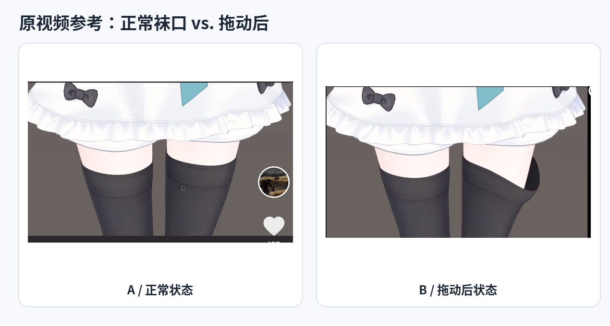
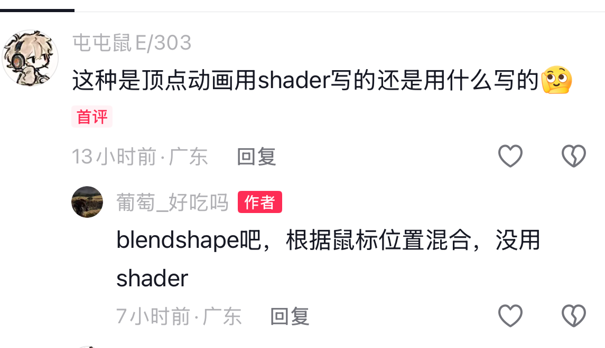
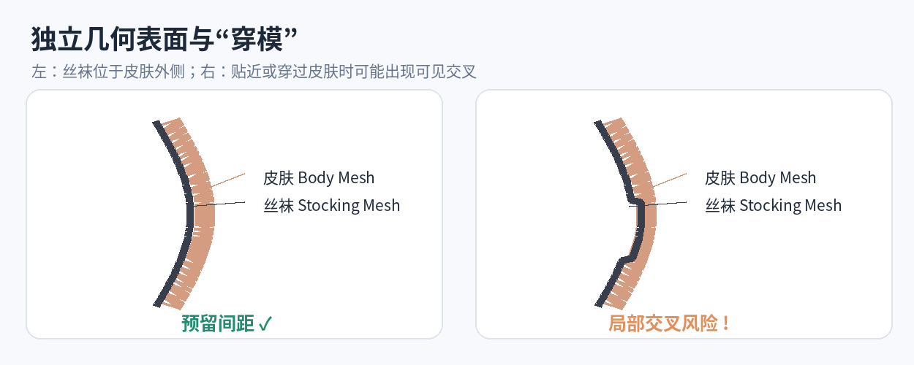
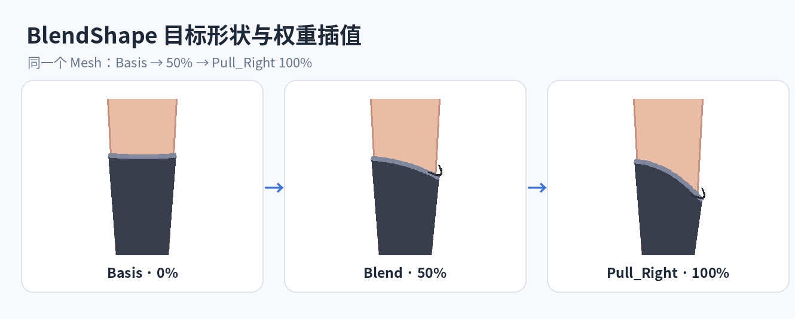
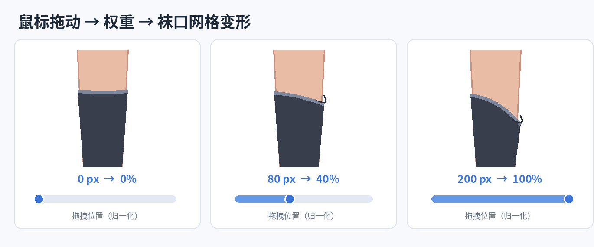
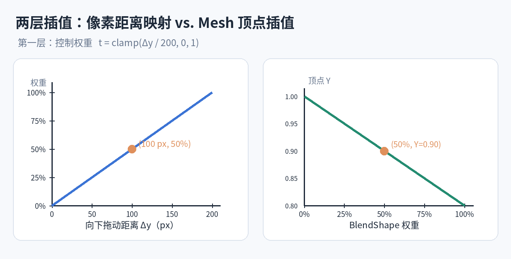
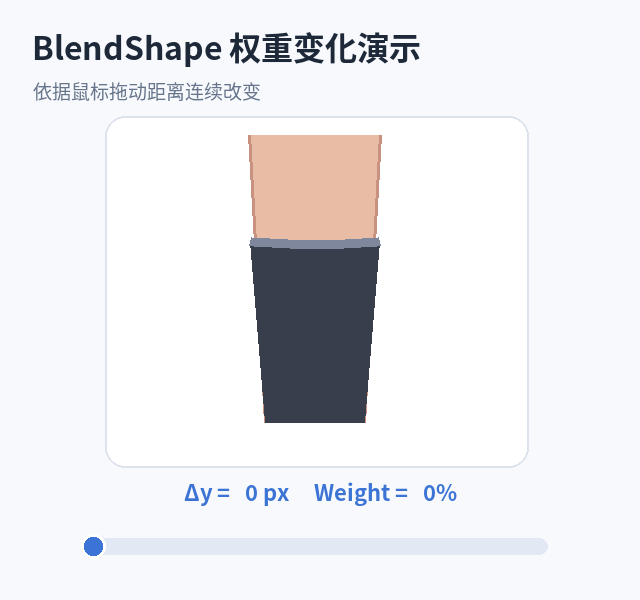
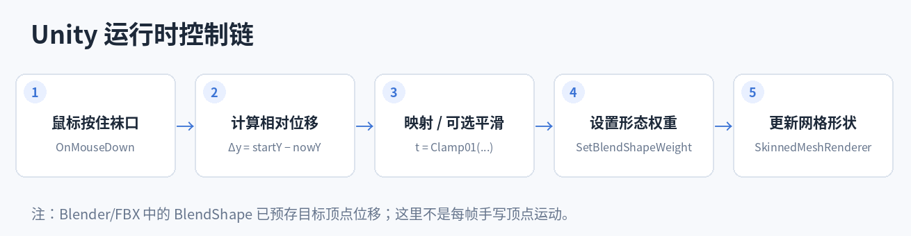

# Unity 可拖拽过膝袜：BlendShape、网格、鼠标交互与插值

> **学习主题**：Unity 角色交互 / Mesh Deformation / BlendShape（Blender 中称为 Shape Key）/ Skinned Mesh Renderer  
> **案例来源**：用户提供的短视频截图与作者评论截图（账号显示为「葡萄_好吃吗」）。  
> **图示说明**：`reference_*.png` 是原始截图或从原始截图裁切的局部；`diagram_*.png` 与 `animation_*.gif` 是为理解原理绘制的教学示意，不是作者工程的截图，也不能用来证明作者具体建模方式。

## 0. 先看参考图片与作者回复



**图 0-1**：左侧为正常穿着状态，右侧为被拖动后、袜口局部降低且倾斜的状态。两张图分别来源于用户上传的截图。



**图 0-2**：评论中有人问是否用 Shader 实现顶点动画；作者答复大意是：**采用 BlendShape，根据鼠标位置混合，没有使用专门实现这一变形的 Shader。**

### 可以确认 vs. 不能确认

| 项目 | 结论 | 确信程度 |
|---|---|---|
| 根据鼠标交互产生袜口变形 | 视频和文字共同支持 | 高 |
| 主要使用 BlendShape 控制形变 | 作者直接回复 | 高 |
| 不是通过专门编写的 Shader 控制该形变 | 作者直接回复 | 高 |
| 提前制作 `Pull_Left`、`Pull_Right` 两个 Shape Key | 合理的复刻设计，**不能证明作者这么命名或制作** | 推测 |
| 袜子是独立 Mesh 对象、拥有完整内层人体 | 可能的建模方案，截图**不能确认具体层级或人体拓扑** | 推测 |
| 使用了哪些碰撞、校正 BlendShape 或限制措施 | 未提供工程数据 | 未知 |

需要准确区分：**“没有用 Shader 实现形变”不等于“模型在渲染时没有使用任何 Shader”。** Unity 显示角色时依然需要材质与着色器。

---

## 1. 核心结构：身体表面和丝袜表面

一个直观的复刻方案是让大腿和袜子具有**可独立控制的几何表面**。丝袜网格围绕腿部网格，并比皮肤略微外移，以免两层表面争夺同一空间。



**图 1-1**：二维截面示意。左侧展示正常的内外层关系；右侧展示局部变形后潜在的交叉风险。间隙为便于观察而放大。

例如：

```text
Character (骨骼层级 / Armature)
├── Skeleton
│   └── UpperLeg / LowerLeg 等骨骼
├── Body Geometry
│   └── Leg surface（需要露出的腿部皮肤）
└── Stocking Geometry
    ├── Basis（默认形状）
    ├── Pull_Right（示例目标形状）
    └── Pull_Left（可选目标形状）
```

这里表示**逻辑结构**而非唯一的 Unity 层级：

- 身体与袜子**可以**是两个独立的 Mesh / SkinnedMeshRenderer，也**可以**在一个 Mesh 中由不同的几何区域或子网格表示。
- 必须区分 **Mesh**（顶点、三角形、UV 等几何数据）与 **GameObject**（Unity 场景对象）：它们不是同一概念。
- 两层表面可以受同一骨骼体系驱动；蒙皮权重与相对间距会影响是否穿模。
- 被袜口拉开后将露出的皮肤必须有实际几何表面。**不要求整个人体所有被衣物遮挡的部位都完整建模**。

**与现实丝袜的差别**：现实丝袜靠弹性与受力贴合人体；此方案通常靠预设网格形状、骨骼蒙皮和必要的变形校正，并不默认计算真实布料物理。

### 为什么“正常穿着”未必穿模？

当丝袜网格与皮肤略有距离、并使用协调的 Skin Weights 时，两者会随着腿部骨骼近似同步运动。因此静止站立、普通腿部动作时可以看起来贴合。

**但相同骨骼 ≠ 永远不会穿模。** 蹲下、扭腿、极端动作和拉袜子时都可能产生局部交叉。

---

## 2. BlendShape / Shape Key 是什么？

> **BlendShape = 在相同拓扑的网格上保存“目标顶点位移”，并按权重与 Basis 混合。**

Blender 里常称 **Shape Key**，Unity 里常称 **BlendShape**。示例：

- `Basis`：正常穿着时的袜口几何形状；
- `Pull_Right`：右侧袜口向下倾斜、略微外翻的目标形状；
- `Pull_Left`：如果需要左右自由拖动，可制作另一个目标形状。



**图 2-1**：0% / 50% / 100% 的插值状态。图中形状是教学重绘，并非原视频的实际网格。

### BlendShape 不是一段必须按时间播放的动画

BlendShape 本身主要保存**目标形状及顶点位移**，不等于已经保存了一段随时间变化的完整动画。权重可以由以下输入驱动：

- Animator 动画曲线（按照时间）；
- 鼠标拖拽距离与方向（按照交互）；
- 表情控制参数、音频、脚本、游戏状态。

因此鼠标停下时，权重可以停止变化；鼠标往回拖，变形也可以沿权重反向恢复。**不会自动“播放下一帧”，而是不断重算当前权重下的目标形状。**

### 基本顶点插值

设某个顶点在 Basis 中的位置为 \(P_0\)，目标 BlendShape 的顶点位置为 \(P_1\)，归一化权重为 \(t\)，则：

\[
P(t)=(1-t)P_0+tP_1=P_0+t(P_1-P_0)
\]

例如顶点的本地 Y 坐标：\(Y_0=1.0\)、\(Y_1=0.8\)，当 \(t=0.5\)：

\[
Y(0.5)=1.0+0.5(0.8-1.0)=0.9
\]

Unity 的 BlendShape 系统会对相关顶点执行对应的形变混合；**无需脚本手动逐个移动丝袜所有顶点**。真实的 BlendShape 还可能涉及法线和切线的变形数据。

> **注意**：上述公式描述两个关键形状之间的常见线性插值。Unity BlendShape 也允许一个形态包含多个帧及特定权重，实际结果可以是分段插值，而非只有 Basis 和一个目标点。

---

## 3. 鼠标移动如何变成 BlendShape 权重？

### 第一层：输入距离 → 控制权重

假设在 UI 里设定“鼠标向下拖动 200 px 对应从 0% 拉到 100%”。

Unity 旧版鼠标输入的屏幕 Y 坐标**向上增大**，所以鼠标向下拖动的距离可以定义为：

\[
\Delta y=y_{\mathrm{start}}-y_{\mathrm{mouse}}
\]

之后归一化并限定范围：

\[
t=\mathrm{Clamp01}\left(\frac{\Delta y}{200}\right)
\]

`SetBlendShapeWeight` 传入的是按百分数表达的权重，通常使用 \(100t\)。

| 向下拖动距离 | 归一化权重 \(t\) | 传入 Unity 的权重 |
|---:|---:|---:|
| 0 px | 0 | 0 |
| 50 px | 0.25 | 25 |
| 100 px | 0.50 | 50 |
| 150 px | 0.75 | 75 |
| 200 px 及以上 | 1 | 100 |



**图 3-1**：对应先前的交互滑块示意，用 0、80、200 px 三种位置展示实时权重与袜口形状变化。Markdown 中展示静态快照。

### 第二层：权重 → 顶点位置

Unity 根据 BlendShape 权重，混合 Basis 和目标顶点位置。**这两层插值不是一回事**：前者是输入映射，后者是几何形状的插值。



**图 3-2**：左侧是鼠标距离至百分比权重的线性映射；右侧是单个顶点的 Y 位置随权重变化的线性插值示例。

### GIF：模拟从 0% 拉到 100%，再反向恢复



**图 3-3**：重新制作的演示 GIF。它模拟鼠标拖拽控制 BlendShape 权重，**不是原视频的逐帧提取，也不是 Unity 运行结果**。

### 鼠标左右移动怎么办？

更自由的控制通常需要至少两个方向参数。例如：

\[
t_{\mathrm{pull}}=\mathrm{Clamp01}(\Delta y / D)
\]

\[
t_{\mathrm{right}}=t_{\mathrm{pull}}\cdot\mathrm{Clamp01}(u),\qquad
 t_{\mathrm{left}}=t_{\mathrm{pull}}\cdot(1-\mathrm{Clamp01}(u))
\]

这里 \(u\) 是一个归一化的横向控制参数。然后分别控制 `Pull_Left` 和 `Pull_Right`。这只是**一种设计方案**，实际应根据网格形状与混合结果调整权重函数，避免两个目标形状叠加后产生意外翻折或穿模。作者究竟用了几个 BlendShape 无法仅凭截图确定。

**实际工程注意**：屏幕像素距离简单易做，但对窗口大小、镜头透视、角色深度敏感。复杂的“抓住袜口”交互可以将鼠标射线投到角色周围的拖拽平面，再使用世界或局部坐标的位移映射权重。

---

## 4. 完整运行过程



**图 4-1**：鼠标事件决定权重，Unity 系统负责 Mesh 变形插值。

```text
鼠标指向袜口 → Collider / Raycast 命中
               ↓
鼠标按住，记录起始 Y 坐标和当前权重
               ↓
鼠标拖动，求本次相对位移 Δy
               ↓
根据拖动距离计算 targetWeight（并 Clamp）
               ↓
可选：在 Update() 中平滑当前权重
               ↓
SkinnedMeshRenderer.SetBlendShapeWeight(index, weight)
               ↓
Unity 根据预存的 BlendShape 数据计算变形
               ↓
蒙皮、渲染 → 显示被拖动的袜口
```

### Unity C# 可运行的基础版本

下面的脚本采用 Unity 传统 Input API 与 `OnMouseDown / OnMouseDrag`，最适合复刻一个鼠标拖动某个袜口控制点的基础效果。将脚本挂在**有 Collider 的交互对象**上，并指定含 BlendShape 的 `SkinnedMeshRenderer`。

```csharp
using UnityEngine;

public class StockingDrag : MonoBehaviour
{
    [SerializeField] private SkinnedMeshRenderer stocking;
    [SerializeField] private string shapeName = "Pull_Right";
    [SerializeField, Min(1f)] private float pixelsForFullWeight = 200f;
    [SerializeField] private bool smooth = false;
    [SerializeField, Min(0f)] private float smoothSpeed = 12f;

    private int shapeIndex = -1;
    private float startMouseY;
    private float startWeight;
    private float targetWeight;

    private void Start()
    {
        if (stocking == null || stocking.sharedMesh == null)
        {
            Debug.LogError("Please assign a SkinnedMeshRenderer.");
            enabled = false;
            return;
        }

        shapeIndex = stocking.sharedMesh.GetBlendShapeIndex(shapeName);
        if (shapeIndex < 0)
        {
            Debug.LogError($"BlendShape not found: {shapeName}");
            enabled = false;
            return;
        }

        targetWeight = stocking.GetBlendShapeWeight(shapeIndex);
    }

    private void OnMouseDown()
    {
        if (shapeIndex < 0) return;
        startMouseY = Input.mousePosition.y;
        startWeight = targetWeight;
    }

    private void OnMouseDrag()
    {
        if (shapeIndex < 0) return;

        float dragDown = startMouseY - Input.mousePosition.y;
        targetWeight = Mathf.Clamp(
            startWeight + (dragDown / pixelsForFullWeight) * 100f,
            0f, 100f
        );

        if (!smooth)
            stocking.SetBlendShapeWeight(shapeIndex, targetWeight);
    }

    private void Update()
    {
        if (!smooth || shapeIndex < 0) return;

        float current = stocking.GetBlendShapeWeight(shapeIndex);

        // 逐渐靠近目标权重；适合做轻微滞后感
        float factor = 1f - Mathf.Exp(-smoothSpeed * Time.deltaTime);
        float next = Mathf.Lerp(current, targetWeight, factor);
        stocking.SetBlendShapeWeight(shapeIndex, next);
    }
}
```

**配置检查**：

1. 模型确实有 `Pull_Right` BlendShape；Unity Inspector 的 SkinnedMeshRenderer 下能看到对应条目。
2. 交互对象具有 `Collider`，且能收到鼠标消息；当 Collider 被其他物体挡住时需要调整交互射线与碰撞设置。
3. 工程采用支持 `Input.mousePosition` 的输入配置（传统 Input Manager 或启用兼容）；纯 New Input System 工程需要改为其 Pointer/Mouse API。
4. `pixelsForFullWeight` 代表屏幕像素位移阈值，取 200 只是例子。
5. 代码只影响一个 BlendShape；要做左右选择，需要额外的命中区域判定及权重混合逻辑。
6. 鼠标放开后，此示例**保留当前权重**；要自动回弹，可以在 `OnMouseUp` 中把 `targetWeight` 重置为 0（同时启用平滑）。

### Lerp 是不是必须？

**不必须。**

- `SetBlendShapeWeight(index, targetWeight)`：权重立即跟随鼠标输入，而 **Unity 仍然会根据当前权重进行顶点插值**。
- `Mathf.Lerp(current, target, factor)`：是**额外平滑权重的变化速度**，用于添加柔和跟随、滞后感；它不是 Mesh 顶点插值的必要前提。
- 当 `Lerp` 每帧以当前值为起点、目标值为终点时，会呈现指数靠近目标的效果，**不是固定时长抵达终点**。上面的指数形式因子可让行为更不依赖帧率。

---

## 5. Blender → Unity：最小复刻步骤

### Blender 端

1. 建立腿部几何与**独立可控制的袜子表面**，袜口最好有足够的顶点环以支持倾斜、卷边和翻折。
2. 将袜子置于皮肤外侧，留出合理的极小间距；不要依赖“双面材质”来解决全部厚度和穿模问题。
3. 将袜子绑定角色骨骼，检查骨骼蒙皮权重，必要时从腿部复制 / 转移合适的权重并微调。
4. 在袜子网格的 **Object Data Properties → Shape Keys** 里创建 `Basis`。
5. 添加一个 `Pull_Right` Shape Key，编辑状态下将袜口右侧顶点拉低并适当外翻；重点检查露出的皮肤和袜口内侧面。
6. 如果要更自由的交互，再添加 `Pull_Left` 或其他方向的 Shape Keys。
7. 在多个 Shape Key 权重下检查姿态是否自然；**保持所有 Shape Keys 的网格拓扑（顶点数量及顺序）一致**。
8. 导出 FBX，确保 Shape Key / BlendShape 数据与蒙皮信息被正确导出；避免让改变拓扑的修改器破坏 Shape Key 导出。

### Unity 端

1. 导入 FBX，展开 `SkinnedMeshRenderer` 并确认 BlendShape 存在。
2. 手动将 BlendShape 权重从 0 改到 100，先检查**不依赖鼠标**的纯变形效果。
3. 加入用于鼠标命中的 Collider / 交互区域，再挂载上方脚本。
4. 检查鼠标的拖动方向、屏幕像素位移、权重上下限与交互手感。
5. 用站立、弯腿、迈步等不同角色姿态测试穿模。

**推荐排错顺序**：先在 Blender 证明目标形状正确 → Unity Inspector 中手动调整权重正确 → 最后再调试鼠标和代码。这样可以快速判断是建模问题还是交互问题。

---

## 6. 为什么有时候会穿模？如何处理？

BlendShape 只知道“把一批顶点推向目标形状”，**它本身不会自动理解人体轮廓或与皮肤碰撞**。

| 情况 | 可能的原因 | 常见处理方式 |
|---|---|---|
| 正常站立就有皮肤穿出丝袜 | 袜子与皮肤初始表面太近或相交 | 调整网格轮廓与表面间距 |
| 抬腿或蹲下时穿模 | Body 和 Stocking 的蒙皮权重 / 变形轨迹不一致 | 调整 Skin Weights，极端姿势增加校正形态 |
| 拖袜口时穿进大腿 | 目标 BlendShape 与身体曲面交叉 | 重新雕刻目标形状、控制拉伸范围 |
| 袜口翻折处异常缺面 | 内侧几何缺失、法线问题或背面剔除 | 建模添加内侧面 / 厚度，检查法线和材质 |
| 多个 Shape Key 同时混合时形状怪异 | 顶点位移相加产生非预期几何 | 限制组合权重、重新制作组合目标或增加校正 |
| 角色大幅动作时难以兼顾 | 单一静态形态不能适配所有骨骼姿势 | Corrective BlendShape、运行时形变校正、必要时布料碰撞 |

### 对本案例的合理推断

作者可能通过**留表面间距 + 手工制作袜口形状 + 控制鼠标权重范围**就完成了展示。这个方案适合站立演示和有限动作，但这是我们的推断，不是作者明确公开的实现细节。

需要强调：**“身体完整 + 衣服独立”不等于必然穿模，也不等于自动不穿模。** 决定结果的是实际顶点表面位置、蒙皮权重以及运动过程中的形变关系。

### BlendShape 和骨骼蒙皮能同时使用吗？

可以。角色可以先具有由 Shape Key 描述的局部形变，同时继续被骨骼蒙皮驱动；Unity 的 `SkinnedMeshRenderer` 支持这类组合。只是当姿势极端时，原本在直立姿态下很好看的袜口形状可能仍要做姿态相关校正。

---

## 7. 与 Shader、布料模拟及普通动画的区别

| 技术 | 主要负责什么 | 本案例中的角色 |
|---|---|---|
| **BlendShape / Shape Key** | 在预制的网格形状间混合 | 作者确认的形变主方案 |
| **骨骼蒙皮 / Skinning** | 跟随骨骼使身体与衣服运动 | 让角色动作和局部变形能共存 |
| **Shader 顶点位移** | 通过着色器逻辑计算顶点变形 | 理论上可用，但作者称没有用来实现该变形 |
| **Cloth Simulation** | 通过物理约束、重力、碰撞等模拟布料 | 本效果的局部交互不一定需要 |
| **时间关键帧动画** | 在时间轴上控制参数或姿态 | 也可驱动 BlendShape，但鼠标交互不必依赖它 |
| **Corrective BlendShape** | 针对特殊姿态或形变组合补偿问题 | 防穿模 / 修正极端姿态的一种高级措施 |

**Shader、BlendShape、Bones 不是互斥概念。** 真实角色项目通常几种系统协同工作，只是各自负责的层次不同。

---

## 8. 最终心智模型（用于 TA 学习）

```text
建模资产层（Blender）
  同一拓扑的 Stocking Mesh
  Basis / Pull_Right / Pull_Left
                   │
                   ↓
导入运行时（Unity）
  SkinnedMeshRenderer 内有 BlendShape 数据
                   │
                   ↓
交互逻辑（C#）
  鼠标命中 + 记录起点 + 位移映射
  Δy → Clamp01 → 权重 0～100
                   │
                   ↓
参数更新
  SetBlendShapeWeight(...)
                   │
                   ↓
几何结果
  Unity 按权重混合目标顶点位移
  + 骨骼蒙皮 / 可选校正
                   │
                   ↓
可见效果
  袜口随鼠标下拉 / 抬回，并露出原本被覆盖的皮肤
```

**一句话总结**：先在 Blender 制作不同的袜口网格目标形状，然后在 Unity 把鼠标拖动位置映射到 BlendShape 权重；Unity 负责顶点插值，而建模、蒙皮与校正负责让它看起来自然、不穿模。

### 容易混淆的三点

1. **Shape Key / BlendShape 不是“先做了一整段逐帧动画”**：它主要预存形态和顶点位移，播放速度或当前位置由外部控制。
2. **鼠标距离映射和顶点插值是两层不同计算**：`Mathf.Lerp()` 可以使参数变化更平滑，但不是令 BlendShape 生效的必要条件。
3. **独立服装表面不会天然进行布料物理模拟**：几何贴合、形变权重、角色姿势、穿模校正是不同问题。

---

## 9. 附录：完整原图

两张用户截图在 `./images/` 中完整保留，方便之后回到原始资料核对细节。

- [原截图 1：正常袜口](./images/blendshape-stocking/reference_original_normal.png)
- [原截图 2：变形状态与作者评论](./images/blendshape-stocking/reference_original_dragged_comment.png)
- [裁切的正常状态](./images/blendshape-stocking/reference_normal_detail.png)
- [裁切的变形状态](./images/blendshape-stocking/reference_dragged_detail.png)

**文件夹结构**：

```text
Unity_BlendShape_Stocking_Notes/
├── Unity_BlendShape_Stocking_Study.md
└── images/
    ├── reference_original_normal.png
    ├── reference_original_dragged_comment.png
    ├── reference_normal_detail.png
    ├── reference_dragged_detail.png
    ├── reference_author_reply.png
    ├── reference_side_by_side.png
    ├── diagram_mesh_layering.png
    ├── diagram_blendshape_targets.png
    ├── diagram_mouse_drag_states.png
    ├── diagram_two_interpolations.png
    ├── diagram_control_pipeline.png
    └── animation_blendshape_weight.gif
```

> **Typora**：解压 ZIP 后，直接用 Typora 打开 `.md`；请保持 `images/` 和 Markdown 文件的相对位置不变。GIF 可在支持 GIF 的 Markdown 渲染器中动起来，若导出 PDF，则通常只显示其中一帧。